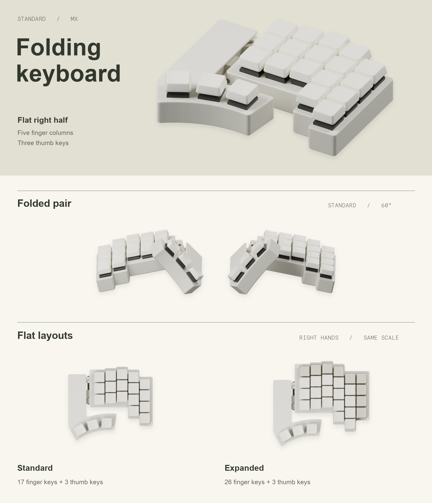

# KobitoKey-inspired folding keyboard

## Expanded hot-swap keyboards

Both editions have **58 south-facing switches**, a 19.05 mm finger pitch, and three folding thumb keys per hand. Choose the PCBs, plates and sockets for your switches.

| Switch edition | Complete package | Build guide |
| --- | --- | --- |
| Full-height MX · revision B | [Download MX](Expanded-MX-PCB.zip) | [MX parts and assembly](pcb/README.md) |
| Low-profile Kailh Choc V2 | [Download Choc V2](Expanded-Choc-V2-PCB.zip) | [Choc V2 parts and assembly](choc-v2/README.md) |

## Hand-wired MX case

The standard model preserves the 17 finger positions and three-key thumb fan on each hand. The expanded model adds a far row and an outer column to the main grid, bringing each hand to 29 switches. Both use the same thumb shell, hinge and thumb plate. The instructions below cover the hand-wired mechanical prototype. The [hinge sourcing notes](hinge-sourcing.md) cover two commercial torque-hinge candidates.



## Layout and source

The standard finger matrix uses 19.05 mm pitch. The three thumb switches follow the original fan in front of the inner finger columns. Their center spacing scales with the original layout, so it is wider than one finger-key pitch. The return beside the finger deck is closed for this trackball-free build. A future sensor, ball retainer and controller mount would require their own mechanical design.

The switch positions came from measurements of the maker’s v1.0.1 plate openings. Coordinates below are for the left hand, relative to the innermost front finger switch. Positive X points inward and positive Y points toward the far row. The right hand mirrors X and yaw.

| Thumb key | X at MX scale | Y at MX scale | Yaw |
|---|---:|---:|---:|
| Under finger bank | −12.70 mm | −38.83 mm | 0° |
| Middle | +10.33 mm | −41.64 mm | −14° |
| Inner tip | +32.02 mm | −49.96 mm | −28° |

The extra row sits beyond the existing back row. The new outer column follows the pinky stagger. All 20 original positions stay fixed relative to the index key. In the saved files, the added nine cap proxies per hand form a separate object named `fixed_caps_added`.

[Measured layout overlay](layout-fit.png) · [Maker’s CAD release](https://github.com/juichi50iii/KobitoKey_QWERTY/releases/tag/v1.0.1) · [Product site](https://juichi50iii.github.io/kobitokey-site/) · [Kit listing](https://iikagen-11.booth.pm/items/7511680)

## Open and pose

1. Open `models/Standard.blend` or `models/Expanded.blend`. The **Controls** object is selected.
2. In **Object Properties → Custom Properties**, drag **thumb_fold_deg** or enter a number from 0 to 60. The finger deck stays fixed in this editing scene.
3. To inspect both hands, use Blender’s scene selector to switch to **Split keyboard** and press **Home** over the viewport to frame the pair. The right half mirrors edits and fold adjustments to the left.
4. Hide the purchased-parts collection to inspect the bare case. The shaded switches and dished caps are fit and visualization proxies. Every printable part is a separate mesh. The source scripts are included alongside the models and in Blender’s Text Editor.

The angle is between decks. For use at 60°, tip the entire half onto the outer edges of both shells to form a tent. The main deck then sits roughly 12° above the desk on the standard half and 11° on the expanded half. The indexed lock holds **flat or folded**. Remove the locking screw to move between those positions.

## Print and assemble

Print one each of the four STLs in each hand folder for the chosen variant, eight parts per keyboard. The hand-specific files are already mirrored. Import in millimeters at 100%. The shells are floor-down and the removable plates are top-face-down with their posts pointing up. The nominal switch openings are 14.00 mm square through a 1.50 mm plate.

| Per half | Quantity | Fit |
|---|---:|---|
| MX-compatible 1u switches and caps | 20 standard or 29 expanded | 18.2 mm square keycap envelope used for fold testing |
| M3 × 50 socket-head screw and M3 nyloc nut | 1 each | Axle, 3.5 mm printed bores, head up to Ø5.5 × 3 mm, nut up to Ø6.4 × 4 mm; no washers |
| M3 × 10 socket-head screw | 1 | Removable angle lock, same head envelope |
| M3 brass heat-set insert | 1 | Ø4.0 × 4.0 mm body, Ø3.65 mm modeled pilot. Match the insert supplier’s pilot recommendation to your material |
| M2.5 × 8 countersunk plastic thread-forming screws | 9 | Five finger plate posts and four thumb plate posts, 2.1 mm blind pilot, 90° countersink, head diameter up to 5.1 mm |

1. Print one thumb plate to check switch retention and one shell pair to check the hinge before committing to the full keyboard. PETG with a 0.4 mm nozzle, 0.2 mm layers and four walls is a starting point for shells. Use a layer height that reproduces the 1.5 mm plate thickness, such as 0.15 mm. Support the horizontal knuckles locally and clear their bores before assembly.
2. With the thumb shell detached, press the heated insert flush into its **single offset bore**, from the rear (+Y) face of the moving ear. The main shell’s matching ear has two offset holes. The central holes take the axle.
3. Interleave the knuckles with the shells flat. Lift the case and hold the axle nut against the forward fixed ear from below. Feed the M3 × 50 axle from the rear. Leave it free enough to pivot without pulling the knuckles together.
4. Snap switches into the plates and hand-wire them. Use the paired rear ports for a flexible external service loop behind the hinge. Route the host/controller lead through the separate rear opening on the finger shell. Size and secure the loop on the actual assembly across the full fold. Electronics, strain relief and a controller-specific cradle are left to the builder.
5. Lower each plate onto its shell and fit the M2.5 screws from underneath. At 0° or 60°, pass the M3 × 10 locking screw through the aligned fixed-ear hole and into the insert. Remove it fully before changing angle.

[Exploded view](case-parts.png)

## Verification and limits

Both editable models were generated and reopened with Blender 5.2.4 LTS. The fold validator evaluates both ends and 119 intermediate poses. It checks every fixed mesh against every moving mesh, including hidden 18.2 mm full-stroke switch/keycap envelopes and the axle. The continuous lower bound subtracts the maximum possible motion between samples. The second hand is an exact reflection.

The smallest sampled gap was 0.248 mm at the axle. The conservative lower bound over the whole fold was 0.205 mm there and 0.4995 mm between printed parts.

The STL checker reads each exported file independently, tests topology and self-intersections, and probes switch apertures, mounting holes, switch-body clearance and cable passages. A separate hardware check examines screw, nut and insert fit and access. The reports record file hashes and the assumptions used.

No physical print, typing-load test, wire-flex life test or printer-tolerance study has been performed. Printer shrinkage, cap profile, switch clips and insert dimensions can change the fit.

[Standard fold report](validation/Standard.json) · [Expanded fold report](validation/Expanded.json) · [Hardware report](validation/hardware.json) · [STL report](validation/parts.json)

## Rebuild

From this folder, using fish on macOS, run the following commands. In Codex on this Mac, run all Blender commands outside the sandbox per AGENTS.md.

```fish
set blender_bin /Applications/Blender.app/Contents/MacOS/Blender
$blender_bin -b --factory-startup --python-exit-code 1 --python build.py
for variant in Standard Expanded
    $blender_bin -b models/$variant.blend --python-exit-code 1 --python validate_fold.py -- --max-step 0.5 --output validation/$variant.json
end
$blender_bin -b --factory-startup --python-exit-code 1 --python validate_hardware.py
python3 validation/check_parts.py
python3 preview.py
```

The STL checker uses NumPy. The preview script uses Pillow and invokes Blender to render the saved models.
