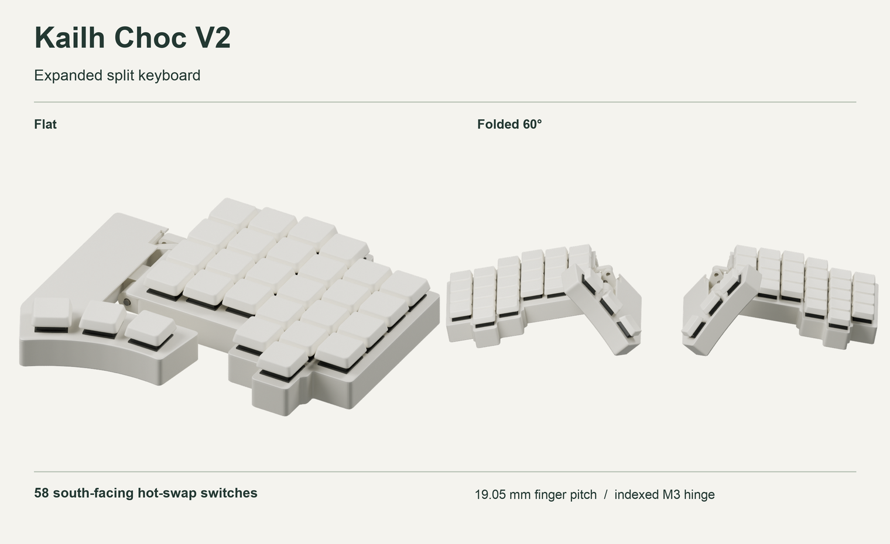

# Expanded Choc V2 keyboard

This low-profile split uses **58 south-facing Kailh Choc V2 switches**. Each hand has 26 finger keys and a folding three-key thumb fan. It keeps the 19.05 mm finger pitch, key centers and thumb angles of the expanded MX keyboard. The Choc plate sits 2.20 mm above the top of the PCB, 2.80 mm closer than the MX plate. Both editions use the indexed M3 hinge and a separate wireless controller per hand.

## Parts for one keyboard

Use 58 **Kailh PG1353** switches, 58 **Kailh CPG135001S30** hot-swap sockets and 58 low-profile 1u keycaps specified for the Choc V2 cross stem. Red linear **CPG135301D01** is the dimensional reference for this version. The asymmetric retention slot is on the LED side. The switch windows face the typist from the keycap side and follow each thumb key’s angle. This version has no per-key LED circuit. [Switch drawings](https://www.kailh.net/pages/product-datasheet) · [Socket drawing](https://cdn-shop.adafruit.com/product-files/5118/5118-Choc-Socket.pdf) · [Purchasing BOM](BOM.csv)

| Board (one each) | Editable KiCad project | Gerbers and drills |
| --- | --- | --- |
| Left finger | [Project](pcb/left-finger/left-finger.kicad_pro) | [Fabrication ZIP](pcb/fabrication/left-finger-fabrication.zip) |
| Left thumb/controller | [Project](pcb/left-thumb/left-thumb.kicad_pro) | [Fabrication ZIP](pcb/fabrication/left-thumb-fabrication.zip) |
| Right finger | [Project](pcb/right-finger/right-finger.kicad_pro) | [Fabrication ZIP](pcb/fabrication/right-finger-fabrication.zip) |
| Right thumb/controller | [Project](pcb/right-thumb/right-thumb.kicad_pro) | [Fabrication ZIP](pcb/fabrication/right-thumb-fabrication.zip) |

[View the routed boards](pcb/preview.png) · [Switch, fabrication and firmware checks](validation/README.md)

## Build a first pair

1. **Test one switch.** Print the [one-switch fit coupon](case/choc-fit-coupon.stl) using the same filament, layer height and slicer compensation you intend to use for the plates. Check that the rim rests flat, the clips engage, and your keycap reaches full travel without rubbing. Print the [two A4 fit sheets](fit-sheets.pdf) at Actual Size and check the 50 mm bar with a ruler.
2. **Print one hand.** Select its fixed shell, fixed plate, thumb shell and thumb plate from the [case files](case/print/). Dry-fit the hardware and boards, starting with the moving thumb deck. To inspect the assembly digitally, select Controls in the [Blender model](case/Expanded-Choc-V2.blend) and adjust the thumb fold angle from 0° to 60°. Install the angle-lock screw for use at 0° or 60°.
3. **Order four different boards.** Upload each fabrication ZIP separately. Specify two-layer 1.6 mm FR-4, 1 oz copper and unplated routed slots. Check each handed outline and verify the offset retention slots in the fabricator’s drill preview. The placement CSVs and inspection reports accompany the [fabrication archives](pcb/fabrication/).
4. **Assemble the backs.** Fit a Choc socket and SOD-123 diode at each switch position. The diode band goes to pad 1. Fit the Hirose J1 flex connector on each board. Fit the XIAO nRF52840 directly to its lands (including underside battery and ground lands), S1, and the J2 battery jack on each thumb board. Assemble the matrix first on USB. The XIAO modules provide USB-C, battery charging and Bluetooth. [Controller documentation](https://wiki.seeedstudio.com/XIAO_BLE/)
5. **Connect and test.** Fit a 12-position 0.50 mm-pitch ribbon with opposite-side contacts and 0.30 mm mating tips. With power off, check J1 pin 1 to pin 1 through 12 to 12. Check for shorts between the battery supply and ground. Check J2 lead polarity before fitting an optional protected cell. Flash the [left and right firmware](firmware/README.md), test all 29 positions per hand and support each socket while inserting its switch.
6. **Exercise the fold.** Route a slack loop behind the hinge and protect it at the shell openings. With the angle-lock screw removed, move slowly through the range and check for cable tension, creasing, rubbing, desk contact and dropped keys. The rigid-part simulation leaves cable flex life, print tolerances, radio range and assembled operation for a physical prototype. [Case and fold checks](case/README.md)

## Editing

Keep each KiCad project beside the supplied symbol, footprint and model libraries. The four native boards are the manufacturing masters. The [firmware configuration](firmware/config/) contains the matrix and three keymap layers. The build uses the name **Lexx Choc V2** over Bluetooth so you can distinguish it from **Lexx MX**.
