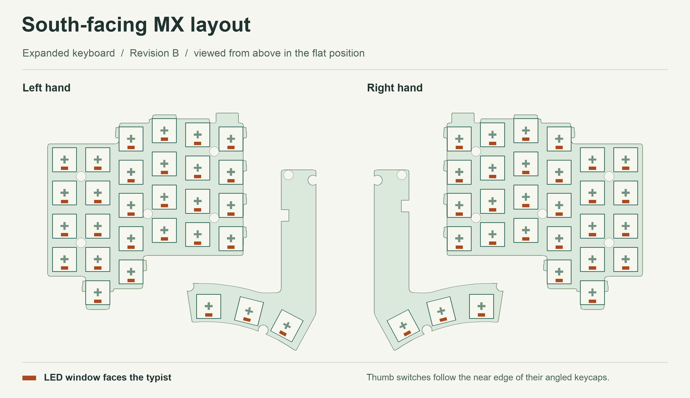

# Expanded MX hot-swap PCB · Revision B

All **58 MX switches face south**. Looking down at the keys, the LED window sits on the edge nearest the typist. Each thumb switch follows its angled keycap. This revision uses Kailh hot-swap sockets and has no per-key lighting circuit.

Each hand has a passive 26-key finger PCB and a three-key moving thumb PCB. The thumb board carries a Seeed XIAO nRF52840, USB-C, the battery connector and the power switch. One 12-conductor flex cable connects the two boards within a hand. The left and right controllers communicate over Bluetooth. Revision B retains the original 19.05 mm finger pitch and three thumb centers, and uses the indexed 0–60° hinge.



[View the copper layers on all four boards](preview.png).

The [populated left-hand underside](left-assembly.png) shows the Kailh sockets and the thumb controller at their flat-case positions. The controller and battery connector use simplified package models.

## Files for one keyboard

| Board | Editable KiCad 10 project | Fabrication archive | Quantity |
| --- | --- | --- | --- |
| Left finger | [Project](left-finger/left-finger.kicad_pro) | [Gerbers and drills](fabrication/left-finger-fabrication.zip) | 1 |
| Left thumb/controller | [Project](left-thumb/left-thumb.kicad_pro) | [Gerbers and drills](fabrication/left-thumb-fabrication.zip) | 1 |
| Right finger | [Project](right-finger/right-finger.kicad_pro) | [Gerbers and drills](fabrication/right-finger-fabrication.zip) | 1 |
| Right thumb/controller | [Project](right-thumb/right-thumb.kicad_pro) | [Gerbers and drills](fabrication/right-thumb-fabrication.zip) | 1 |

Keep the project folders together with the shared symbol and footprint libraries. Each project contains its own editable schematic and routed board. Each archive describes a separate **two-layer, 1.6 mm FR-4 bare PCB**. Specify 1 oz copper. Import all layers and both drill types in millimeters and preserve handedness.

Use the [purchasing BOM](BOM.csv), [PCB case and printable shells](case/README.md), [production files and placement CSVs](fabrication/) and [firmware and flashing instructions](firmware/README.md). Use the revision B finger shells and finger plates together. The central screw moves 3.77 mm toward the rear, and the rear edge extends around the relocated flex connector. The [case print guide](case/README.md) identifies the matching parts for both hands.

## What follows the original

The original kit and build guide establish the two-board layout, flexible link, controller location and diode matrix. The published firmware gives the XIAO GPIO assignments. The maker's public release provided case models and firmware. The schematics, routing, hot-swap placements and expanded matrix here were designed for the new MX case. The nine added switches per hand need six columns and five rows. The original 10-position flex is too small for that passive matrix. All 11 header GPIOs now serve the keyboard, so a later trackball requires a new interface. [Design sources and footprint credits](ATTRIBUTION.md)

| J1 pin | 1 | 2 | 3 | 4 | 5 | 6 | 7 | 8 | 9 | 10 | 11 | 12 |
| --- | --- | --- | --- | --- | --- | --- | --- | --- | --- | --- | --- | --- |
| Signal | R0 | R1 | R2 | R3 | R4 | C0 | C1 | C2 | C3 | C4 | C5 | unused |
| XIAO pin | D1 | D2 | D3 | D6 | D0 | D10 | D9 | D8 | D7 | D4 | D5 | — |

Each switch connects a column to the anode of its diode. The cathode connects to the row. R0/C0 through R0/C2 are the original thumb fan. The two lower pinky-side finger positions occupy R0/C3 and R0/C4. R0/C5 is open. SW1–SW26 live on the finger PCB. SW27–SW29 live on the thumb PCB. Reference numbers repeat on the opposite hand.

## Assemble and bring up the first pair

1. **Check fit on paper.** Print the [two A4 fit sheets](expanded-mx-fit-sheets.pdf) at actual size. Measure the 50 mm scale bar and align the switch centers and post holes against the matching revision B plate. The marks beside the centers identify the LED-window side. Use the revised shells for access to USB, the battery switch and the flex.
2. **Populate the backs.** Fit the bottom-side Kailh sockets and SOD-123 diodes. The cathode band goes to pad 1. Both J1s use the same Hirose bottom-contact socket. The XIAO's own USB-C jack points toward the outer side of the thumb return. Fit the module directly to its lands without pin headers. Paste/reflow the required underside battery and ground lands with the castellations. The USB data lines and charge controller are on the module. [Kailh MX socket](https://www.kailhswitch.com/info/kailh-pcb-socket-for-switch-37972215.html) · [Hirose connector drawing](https://www.hirose.com/product/p/CL0586-0704-0-55) · [Seeed controller documentation](https://wiki.seeedstudio.com/XIAO_BLE/)
3. **Fit the flex.** Use 12 ways, 0.50 mm pitch, opposite-side exposed contacts and 0.30 mm mating tips. A 102 mm jumper is the starting length. Insert both ends fully and close both latches. With power disconnected, check J1 pad 1 to pad 1, then 2 to 2 through 12 to 12. Route a slack loop through the two rear openings and behind the axle. The flex should stay clear of the screws and desk throughout the fold. Check the cable supplier's dynamic bend limits. [Molex candidate](https://www.molex.com/en-us/products/part-detail/150782412)
4. **Check power without a battery.** On the unpowered board, check for shorts between BAT_POS, VBAT_SW, ground and the module's 3V3 pad. S1 should connect J2 pin 1 to U1 pad 19 in only one position. J2 pin 2 should connect to ground in either position. Power each XIAO by USB and flash the matching [left](firmware/bin/lexx_left.uf2) or [right](firmware/bin/lexx_right.uf2) image. Pair the halves. Momentarily bridge the two switch contacts at each position to test the matrix before installing the switches.
5. **Install the switches.** Looking down at a flat hand with the thumb keys nearest you, point each LED window toward you. On an angled thumb key, the LED window follows the near edge of that keycap. Align the two metal pins with the socket openings before pressing. Support the socket from behind during installation. Check the chosen keycap profile through a full stroke on the narrow pinky column and the three thumb keys.
6. **Fit the optional batteries.** Use one protected 1S LiPo per side, within the case's 18 × 24 × 4 mm body envelope, with a charge-current rating suitable for the XIAO. Verify the actual lead polarity with a meter before mating the plug. Pin 1 is positive. Pin 2 is ground. The battery charges through the XIAO when S1 connects it. S1 disconnects the battery in the other position. USB can still power the module. Secure the pack and leave the plug, flex and antenna clear.
7. **Exercise the hinge.** Test several chords across both halves at 0° and 60°. Move slowly through intermediate positions with the index screw removed. Check for key dropouts, cable tension, creasing or rubbing. Verify wireless range and check USB plug access with the cable and shell you plan to use.

## Verification and scope

KiCad's ERC checks the schematic. DRC checks the board geometry and copper connections, including schematic parity. All four boards passed ERC and DRC with zero warnings, errors, open connections or schematic mismatches. The per-board reports live beside the Gerbers. The case checks compare the actual board outlines with the printed shells and plate posts. Each board sits with its top 5 mm beneath the plate top. The smallest PCB-to-shell gap is 0.38 mm. The socket bodies clear the shell by at least 0.99 mm. Both hands retain at least 1.0 mm of clearance between the rigid electronics and the opposing deck or hinge hardware through 0–60°. [Measured case fit](case/board-fit.json) · [Rigid fold sweep](case/fold.json) · [Electronics fold sweep](case/electronics-fold.json)

The fold sweep covers the rigid parts and switch/keycap envelopes. Cable fatigue, battery-lead routing, RF range, USB plug overmold clearance, typing load, solder assembly and printer tolerance need physical testing. The printable shells use the indexed M3 hinge. The optional Ø4 × 11 mm commercial hinge takes a separate keyed mount.

## Recheck a design

Open a project in KiCad to edit the schematic or copper. To check all four projects from a terminal, put KiCad 10's CLI on PATH and run these commands from this directory.

```fish
python3 tools/verify_matrix.py
for board in left-finger left-thumb right-finger right-thumb
    kicad-cli sch erc --exit-code-violations -o /tmp/$board-erc.rpt $board/$board.kicad_sch
    kicad-cli pcb drc --schematic-parity --exit-code-violations -o /tmp/$board-drc.rpt $board/$board.kicad_pcb
end
```

Run `tools/verify_switches.py` with KiCad’s Python interpreter (`pcbnew`) to check the physical contact and locating holes against the intended LED-window direction, key centers, and matrix. To regenerate the A4 fit sheets, run `python3 tools/fit_sheet.py --kicad-python /path/to/kicad/python3` with ReportLab available to the outer interpreter.

The routed KiCad boards are the manufacturing masters. To replot one, use KiCad's Python interpreter with the `pcbnew` module and run `tools/route_and_plot.py left-finger/left-finger.kicad_pcb --output fabrication`. For a new layout, use a separate checkout. `tools/plan.py` (Python with Shapely) derives the outlines from the case. `tools/schematics.py` builds the diagrams from the pin manifests and `tools/place.py` builds fresh, unrouted boards with KiCad's Python. Routing includes hand finishing. Recheck schematic parity, copper, physical fit and the firmware matrix after changing geometry.
