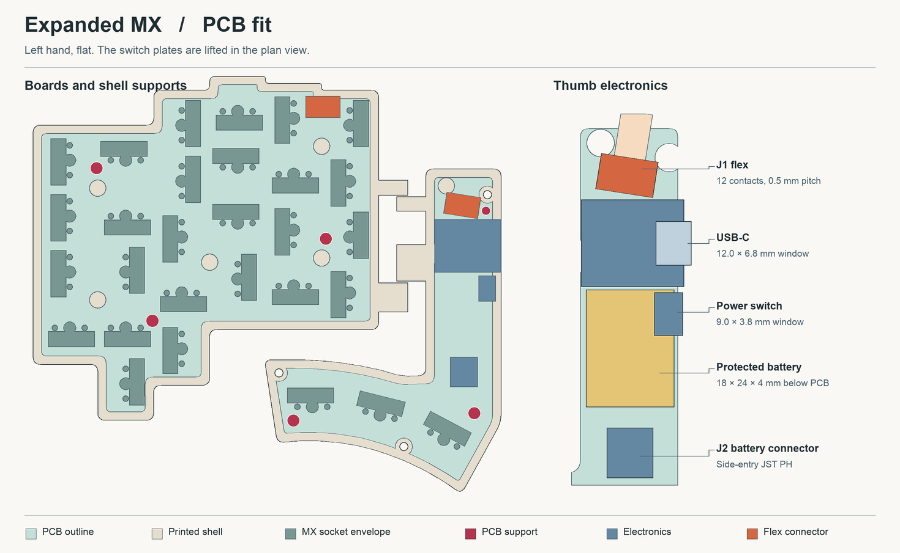

# Expanded MX case for the PCB assembly

Print the four [PCB shells](print) and use the [original expanded MX switch plates](../../print/expanded). Open [Expanded-PCB.blend](Expanded-PCB.blend) to edit the case or inspect the electronics. Each half has 26 finger switches and three thumb switches.

- **PCB workbench** shows all four editable board meshes and their placed components. Press Home to frame the boards and Ctrl + Numpad 7 for the component-side view. The board solids follow the actual KiCad perimeters, post cuts, MX and switch locating drills. Component bodies and protected cells are mechanical envelopes. Copper, vias and the free cable loop are documented in the KiCad files and assembly guide.
- **Edit left hand** shows the case and electronics together. Select Controls and adjust the `thumb_fold_deg` custom property from 0° to 60°. The thumb board, USB socket, switch, battery and other thumb components follow the moving deck.
- **Split keyboard** shows both complete hands. Both thumb pivots use the same slider. The right-hand PCB meshes and component rotations come from the right-hand design files.



## Shells and fit

The thumb wall has a 12 × 6.8 mm USB opening and a 9 × 3.8 mm power-switch opening. An internal recess clears both shoulders of the XIAO circuit board. The wall behind each shoulder is 1.20 mm thick. The USB nose sits about 0.10 mm inside the outer wall. Check that your cable’s overmold can seat fully through the opening.

| Dimension | Nominal fit |
| --- | --- |
| Switch plate top / bottom | 18.0 / 16.5 mm above the shell base |
| PCB top / bottom | 13.0 / 11.4 mm |
| PCB support height | 11.2 mm, with a 0.20 mm gap at rest |
| Smallest finger PCB to shell gap | 0.24 mm |
| Smallest thumb PCB to shell gap | 0.41 mm right, 0.43 mm left |
| Smallest PCB to plate mounting post gap | 0.39 mm |
| USB center along the wall | Y = +0.5 mm |
| Slide switch center along the wall | Y = −14 mm |

The mounting posts locate the plate. Each MX switch clips into the plate and seats in its matching PCB holes. Three insulating lands under each board limit downward motion. Their top faces clear the modeled component envelopes by at least 0.85 mm. Back each Kailh socket directly while seating switches during initial assembly. If a physical sample needs less vertical play, fit a thin dielectric shim only to a support land and check that the plate still closes without preload.

## Assembly and fold

1. **Print and fit one hand first.** Print shell floors on the bed. Apply local support to the horizontal hinge knuckles as in the [v1 assembly guide](../../README.md). Inspect the short roofs above USB and power access, remove any support under them, and clear both rear cable slots. Dry-fit the boards in the shells and onto the plate posts.
2. **Fit the thumb electronics.** Position the protected cell on the thumb-shell floor with its leads toward J2. The tested envelope measures 18 × 24 × 4 mm, centered at X = ±21 and Y = −21 mm, spanning Z = 2.9–6.9 mm. This allows 0.5 mm for thin retention material above the 2.4 mm floor. Measure the entire covered cell, including its protection board. Leave room for its lead exit and the mated PHR-2 plug. The cell must sit clear of solder joints and fasteners with the plate closed. [JST PH connector drawing](https://www.jst.com/wp-content/uploads/2025/06/ePH.pdf)
3. **Seat the flex with the plates lifted.** Both 8 mm slots open to the shell rim. A 6.5 mm ribbon follows the finger connector straight out. The thumb connector turns the ribbon 9° toward its slot. Along that straight line the ribbon clears the two plate posts by 0.67 and 2.23 mm. The raised, rounded sills let the ribbon pass without threading it through a closed hole. [Hirose FFC insertion guide](https://www.hirose.com/en/product/document?clcode=&documentid=D82_en&documenttype=Guideline&lang=en&productname=&series=FH12)
4. **Fit the external service loop.** Route it behind both shells, clear of the axle and indexing screw. Protect each printed exit from abrasion and restrain the cable on its own deck behind the reinforced end. Leave enough free length for a broad moving bend. Use the unlocked assembly to check both endpoints and intermediate angles for tension, pinching and contact with the desk. Follow the selected cable’s bend-radius and flex-life specifications. The [PCB BOM](../BOM.csv) gives the starting cable length.
5. **Check USB and Bluetooth assembled.** Verify plug insertion and both slide positions on each hand. The radio antenna sits at the end of the XIAO nearest the hinge. The thumb PCB includes an antenna cutout. Keep the battery, spare wire and metallic spacers away from that opening. Check Bluetooth reach with the final battery, hardware and shell at 0° and 60°. [Seeed carrier-board and antenna drawing](https://www.seeedstudio.com/blog/wp-content/uploads/2022/08/Seeed-Studio-XIAO-Series-Package-and-PCB-Design.pdf)

## Verification

- **STLs.** The four binary STLs each form one closed, outward-facing mesh. Their triangles passed winding, degeneracy and self-contact checks. The feature checks probe the actual USB and slide apertures, shoulder-pocket wall and representative component, battery and cable access envelopes. [Shell measurements](shell-checks.json)
- **Board fit.** Each actual KiCad `Edge.Cuts` perimeter was compared with the exported shell and plate facets across the full 1.6 mm laminate thickness. Support heights were measured from the printed shell meshes and compared against the handed underside component placements. [Board fit measurements](board-fit.json)
- **Motion.** The factory Blender 5.2.4 LTS build evaluated 121 positions between 0° and 60°. The closest sampled gap was 0.248 mm. The computed lower bound between samples was 0.204 mm for the modeled case, keys and fit gauges. The purchased hinge fastener envelopes and tool access passed a separate check. [Fold sweep](fold.json) · [Hardware check](hardware.json)
- **Electronics in motion.** A second sweep checked each hand’s actual rig and board placements at 121 positions. The boards, components and cell envelopes maintained at least 1.0 mm to the opposite deck’s electronics, printed parts, key fit gauges and hinge hardware throughout the range. The indexing screw cleared the electronics in both locked positions. The checker caps reported gaps at 1.0 mm. [Electronics sweep](electronics-fold.json)
- **Prototype status.** FDM tolerance, switch insertion loads, USB overmold fit, the flexible cable’s moving path, battery retention and radio range still need a physical sample.

## Reproduce

Run from the repository root. The shell builder reads the committed expanded model. The board-fit checker reads the current four KiCad board files. The Blender commands on this Mac require the approved outside-sandbox execution described in [AGENTS.md](../../AGENTS.md).

```sh
/Applications/Blender.app/Contents/MacOS/Blender -b --python-exit-code 1 --python pcb/case/build_case.py
python3 pcb/case/check_case.py
uv run --no-project --with numpy --with shapely python3 pcb/case/check_boards.py
/Applications/Blender.app/Contents/MacOS/Blender -b pcb/case/Expanded-PCB.blend --python-exit-code 1 --python validate_fold.py -- --output pcb/case/fold.json --max-step 0.5
/Applications/Blender.app/Contents/MacOS/Blender -b pcb/case/Expanded-PCB.blend --python-exit-code 1 --python pcb/case/check_motion.py
uv run --no-project --with numpy --with shapely --with pillow python3 pcb/case/diagram.py
```
